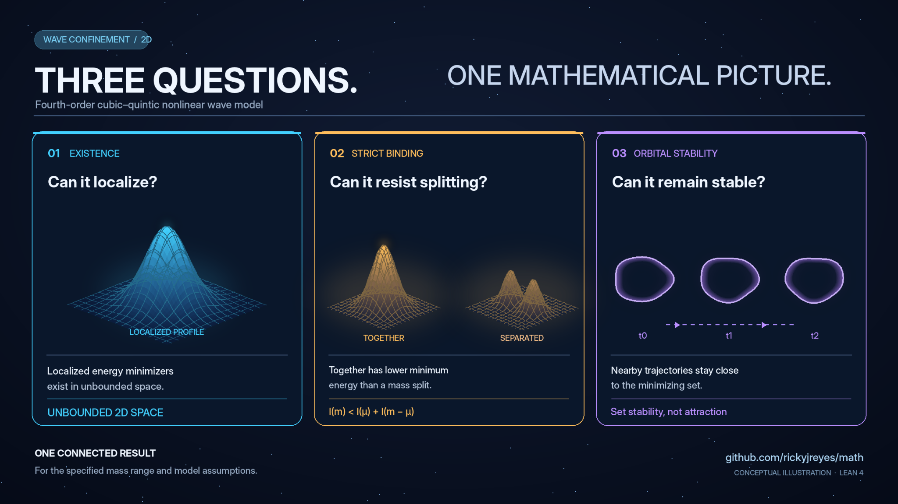
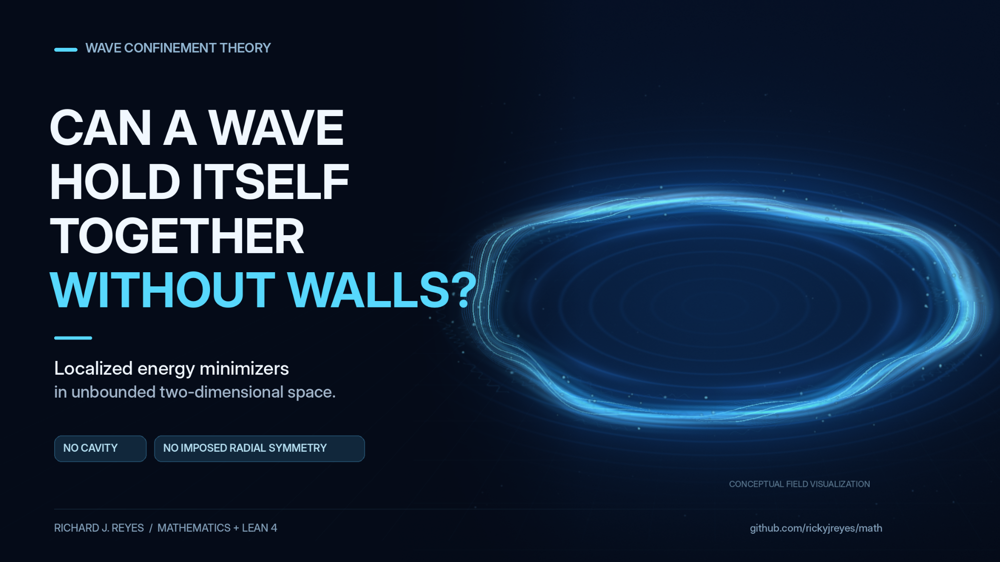
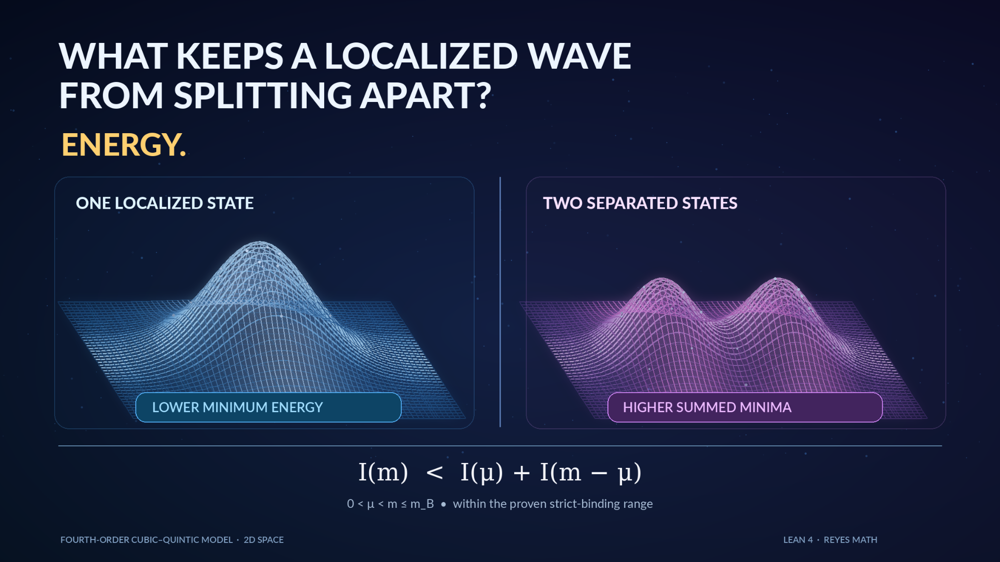
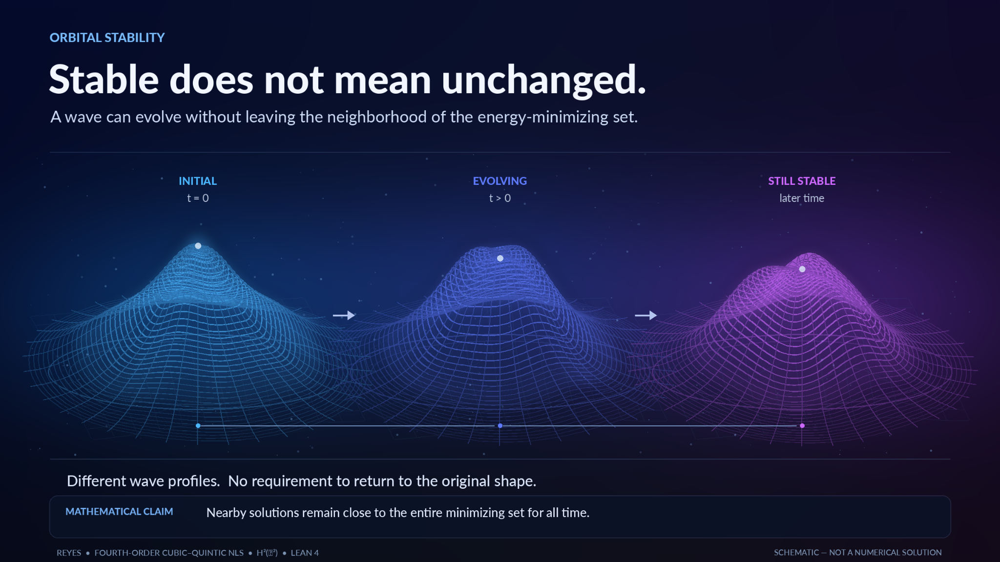

# Research post graphics

Four visual companions to the fourth-order cubic–quintic mathematical results of Richard J. Reyes.

**Evidence classification:** These graphics are **conceptual illustrations**, not outputs of the PDE solver, numerical minimizers, numerical energy comparisons, simulated trajectories, or experimental evidence. Read all mathematical claims with the conditions in the linked papers and Lean declarations.

## One model, three connected results

- **Manuscripts:** [whole-space minimizers](../../../preprints/whole-space-fourth-order-cubic-quintic-minimizers/README.md), [strict binding](../../../preprints/strict-subadditivity-fourth-order-cubic-quintic/README.md), [orbital stability](../../../preprints/orbital-stability-fourth-order-cubic-quintic/README.md)
- **Lean:** [WholeSpaceMinimizers.lean](../../../lean/MathProofs/WholeSpaceMinimizers.lean), [StrictBinding.lean](../../../lean/MathProofs/StrictBinding.lean), [OrbitalStability.lean](../../../lean/MathProofs/OrbitalStability.lean)

## Whole-space localization without cavity walls

- **Manuscript:** [Whole-space constrained minimizers](../../../preprints/whole-space-fourth-order-cubic-quintic-minimizers/README.md)
- **Lean:** [WholeSpaceMinimizers.lean](../../../lean/MathProofs/WholeSpaceMinimizers.lean)
- No radial symmetry is imposed in the theorem. The displayed ring is a conceptual motif, **not** an asserted shape or symmetry of a proved minimizer.

## Strict binding

- **Manuscript:** [Strict subadditivity](../../../preprints/strict-subadditivity-fourth-order-cubic-quintic/README.md)
- **Lean:** [StrictBinding.lean](../../../lean/MathProofs/StrictBinding.lean)
- The actual theorem is `I(m) < I(μ) + I(m − μ)` for `0 < μ < m ≤ m_B`, with the coefficient and model assumptions in the Lean statement. The illustrated surfaces are **not computed minimizers or energy values**.

## Orbital stability

- **Manuscript:** [Orbital stability of the complete minimizing set](../../../preprints/orbital-stability-fourth-order-cubic-quintic/README.md)
- **Lean:** [OrbitalStability.lean](../../../lean/MathProofs/OrbitalStability.lean)
- Stability is of the **full set of minimizers** in `H²(ℝ²; ℂ)`. The stages in the image are **not measured or computed time steps**, and the theorem does not claim attraction or uniqueness.

## Scientific scope

The mathematical model is the specified fourth-order focusing-cubic/defocusing-quintic Hamiltonian on `H²(ℝ²; ℂ)`, within the proven parameter and mass range. These are independent mathematical statements and do **not** by themselves validate a physical free-space confinement mechanism or establish that the illustrated wave profiles solve the PDE.

For the formal research catalogue, see [CONTENTS.md](../../../CONTENTS.md). For the source methodology and theorem limitations, see the [repository README](../../../README.md).
