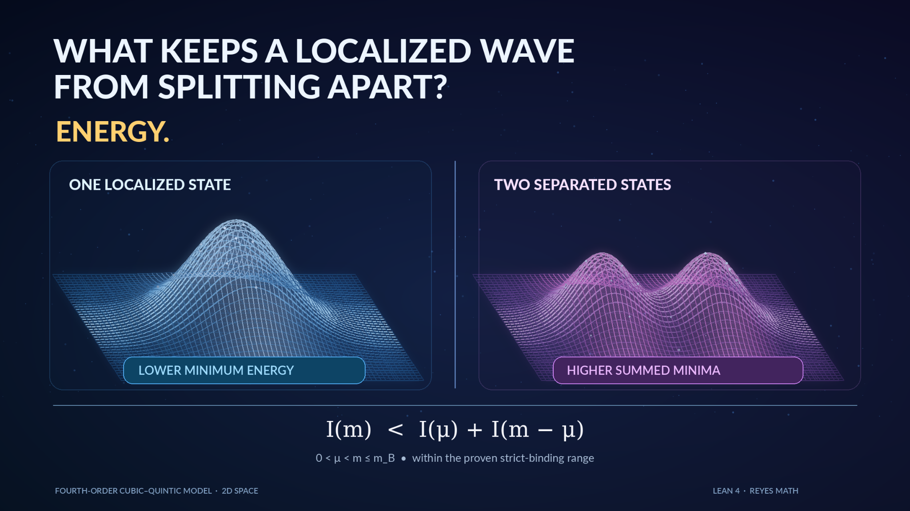

# Strict binding for a fourth-order cubic–quintic Hamiltonian

[PDF](paper.pdf) · [LaTeX](../../papers/strict-subadditivity-fourth-order-cubic-quintic/main.tex)

Family: F01. Research manuscript; not independently peer-reviewed. PDFs are compiled reproducibly by the repository's [build script](../../scripts/build_pdfs.sh) and [workflow](../../.github/workflows/pdfs.yml).

## Conceptual figure

The theorem proves strict subadditivity $I(m) < I(\mu)+I(m-\mu)$ for $0<\mu<m\le m_B$ under its model assumptions. The surfaces are **not** numerical minimizers or measured energy comparisons.

**Source:** [Lean formalization](../../lean/MathProofs/StrictBinding.lean) · [Four-figure gallery](../../docs/figures/research-posts/README.md) · [Combined F01 visual](../../docs/figures/research-posts/existence-binding-stability.png).
