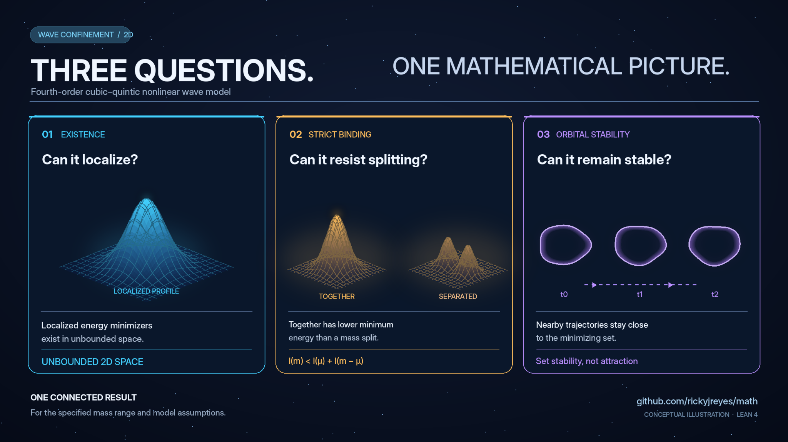

# Adoption inventory: existing Lean proofs, manuscripts, and GC questions

The Reyes Problem Repository is an **open invitation to contribute**, not a separate proof or publication pipeline. Its purpose is to track the mathematical questions motivated by the existing research program, invite human and AI-assisted contributors, and reuse the Lean files and papers **already present**.

## Current existing mathematical results (exact theorem scope)

**Snapshot: November 2, 2026.** The [verified-results index](VERIFIED_LEAN_RESULTS.md) identifies **20 selected Lean proof modules** in this and connected repositories. The green marker here means **the cited, narrower proposition is recorded as formally proved**, not that the full GC question is solved, its physical interpretation established, or an independent Lean rebuild performed for this document. A linked `GC` is a correspondence lead unless reviewed against the entire frozen question.

| Proven exact-scope result | Statement supported by the cited source | Existing Lean/paper source | Relationship to broader challenge |
|:--|:--|:--|:--|
| **Orbital stability** | Orbital stability of the **full set of constrained minimizers** in $H^2(\mathbb R^2)$, in the sufficient mass range; not uniqueness or profile-wise stability | [OrbitalStability.lean](../lean/MathProofs/OrbitalStability.lean), [paper](../papers/orbital-stability-fourth-order-cubic-quintic/main.tex) | [GC01](problems/01-wave-dynamics/GC01.md), partial |
| **Strict binding** | $I(m)<I(a)+I(m-a)$ for every split $0<a<m$ in the proved mass range | [StrictBinding.lean](../lean/MathProofs/StrictBinding.lean), [paper](../papers/strict-subadditivity-fourth-order-cubic-quintic/main.tex) | [GC06](problems/02-confinement-curvature/GC06.md), [GC16](problems/04-variational-solitons/GC16.md), partial |
| **Global nonlinear flow** | Global $H^2$ existence, uniqueness, continuous dependence, mass and energy conservation for this two-dimensional equation | [CubicQuinticFlow.lean](../lean/MathProofs/CubicQuinticFlow.lean) | [GC03](problems/01-wave-dynamics/GC03.md), partial; [GC46](problems/10-lean-certified-analysis/GC46.md), exact correspondence not yet signed off |
| **Curvature nonattainment** | Positive-curvature whole-space energy admits no minimizer in the specified setting; strict spreading in dimensions 1–4 | [CurvatureNonattainment.lean](../lean/MathProofs/CurvatureNonattainment.lean) | Related to localization, not a general confinement theorem |
| **E68 dimension classification** | The particular quantified local $H^1$ gradient estimate holds exactly in spatial dimension two | [E68Classification.lean](../lean/MathProofs/E68Classification.lean) | Related to [GC10](problems/02-confinement-curvature/GC10.md), not its full classification |
| **Whole-space $L^2$ Fourier analysis** | Unitary Fourier construction on genuine $L^2$ classes; exclusion of nonzero $L^2$ states supported on a measure-zero frequency shell | [L2Fourier.lean](../lean/MathProofs/L2Fourier.lean) | Related to [GC14](problems/03-spectral-scattering/GC14.md) |
| **Fourier contraction semigroup** | Exact continuous-operator $L^2$ semigroup identity and contractivity for the stated Fourier multiplier | [E57L2Semigroup.lean](../lean/MathProofs/E57L2Semigroup.lean) | Related to [GC48](problems/10-lean-certified-analysis/GC48.md) |
| **V18 local non-identifiability** | Nonlinear $20$-dimensional local fiber of the specified $31$-parameter to $11$-observation map, at the stated frozen model | [V18Identifiability.lean](../lean/MathProofs/V18Identifiability.lean) | [GC26](problems/06-inverse-observation-control/GC26.md), partial |
| **V18 Jacobian rank** | Exact rank $11$ and nullity $20$ at the designated parameter point | [V18Rank.lean](../lean/MathProofs/V18Rank.lean) | [GC26](problems/06-inverse-observation-control/GC26.md), partial |
| **Curvature closure nonuniqueness** | Infinitely many smooth regularized constitutive closures satisfy the stipulated axioms | [M6BClosureTheorem.lean](../lean/MathProofs/M6BClosureTheorem.lean) | [GC08](problems/02-confinement-curvature/GC08.md), partial negative resolution |
| **Smooth-field closure witness** | Distinct admissible curvature closures are distinguishable on an actual smooth field, not just formal jets | [M6BClosureFieldWitness.lean](../lean/MathProofs/M6BClosureFieldWitness.lean) | [GC08](problems/02-confinement-curvature/GC08.md), supporting result |
| **Auxiliary-field obstruction** | Rewriting the specified regular higher-time-derivative temporal-jet model does not remove its Hamiltonian obstruction | [R16_AuxiliaryEquivalence.lean](https://github.com/rickyjreyes/geometry_of_resonance/blob/main/lean/ReleaseProofs/R16_AuxiliaryEquivalence.lean) | Higher-derivative questions, restricted class |
| **Completion-class obstruction** | A delimited higher-derivative failure class and a distinct competing spatial action | [R16_CompletionClasses.lean](https://github.com/rickyjreyes/geometry_of_resonance/blob/main/lean/ReleaseProofs/R16_CompletionClasses.lean) | [GC21](problems/05-higher-derivative-fields/GC21.md), partial |
| **Static finite-wavenumber onset** | Exclusion of a primary finite-$q$ zero-frequency onset in the stated static homogeneous S004 sector | [R18_Onset.lean](https://github.com/rickyjreyes/geometry_of_resonance/blob/main/lean/ReleaseProofs/R18_Onset.lean) | [GC23](problems/05-higher-derivative-fields/GC23.md), partial |
| **Canonical static selection obstruction** | Static spatial-selection obstruction and conditional pole-positivity statements in the specified sector | [R18_CanonicalObstruction.lean](https://github.com/rickyjreyes/geometry_of_resonance/blob/main/lean/ReleaseProofs/R18_CanonicalObstruction.lean) | [GC23](problems/05-higher-derivative-fields/GC23.md), partial |
| **Operator block enclosure** | A rigorous *conditional* operator-norm bound and sound checker given certified block and global-error inputs | [BlockEnclosure.lean](https://github.com/rickyjreyes/wct-pde/blob/main/formal/D4Certificates/BlockEnclosure.lean) | Does not itself certify a production numerical operator |
| **Randomization-test validity** | Finite exact type-I error control under declared randomization/exchangeability hypotheses | [Randomization.lean](https://github.com/rickyjreyes/photodiode/blob/main/formal/PhotodiodeProtocol/Randomization.lean) | Does not establish an optical effect |
| **Split-SAT communication capacity** | Exact split-SAT construction and finite-alphabet information lower bound in the defined model | [SplitSATCapacity.lean](https://github.com/rickyjreyes/PVNP/blob/main/lean/PVNP/SplitSATCapacity.lean) | Does not solve $P$ versus $NP$ |
| **Transcript-count lower bound** | Exponential accepting-transcript bound using the specified communication fooling set | [Communication.lean](https://github.com/rickyjreyes/PVNP/blob/main/lean/PVNP/Communication.lean) | Does not imply a general Turing-machine lower bound |
| **Multi-block state structure** | Proven properties of the defined block-absorption construction and structural non-injectivity limits | [MultiBlock.lean](https://github.com/rickyjreyes/Wavelock/blob/main/lean/WaveLockProofs/MultiBlock.lean) | Does not prove general cryptographic collision resistance |

### Further mathematics already present in `math`

The 20 rows above are **a selected index, not an exhaustive inventory of every theorem file**. The following source modules have additional explicit theorem statements and should be considered before starting duplicate proofs. Their presence was checked against the current GitHub tree, but this update does not independently rerun Lean.

| Source | Existing mathematical content | GC relevance and limitation |
|:--|:--|:--|
| ✅ [WholeSpaceMinimizers.lean](../lean/MathProofs/WholeSpaceMinimizers.lean) | Constrained minimizer existence and compactness modulo translations in the stated two-dimensional mass/parameter regime | [GC06](problems/02-confinement-curvature/GC06.md), [GC19](problems/04-variational-solitons/GC19.md) have narrower solved components; not all-mass classification |
| ✅ [FourierShellL2.lean](../lean/MathProofs/FourierShellL2.lean) | Nonzero `L²` states cannot have Fourier support on a zero-measure isolated frequency shell | [GC14](problems/03-spectral-scattering/GC14.md) is a stronger spectral-localization question |
| ✅ [DispersionMinimum.lean](../lean/MathProofs/DispersionMinimum.lean) | Exact positive-wavenumber minimum of a stipulated linear dispersion branch | [GC11](problems/03-spectral-scattering/GC11.md) also asks about nonlinear wavelength selection |
| ✅ [FourierLeakage.lean](../lean/MathProofs/FourierLeakage.lean) | Explicit nonlinear Fourier convolution and finite-mode leakage in the stated periodic model | [GC13](problems/03-spectral-scattering/GC13.md), [GC15](problems/03-spectral-scattering/GC15.md) require exact correspondence review |
| ✅ [UVIllPosedness.lean](../lean/MathProofs/UVIllPosedness.lean) | A specified fourth-order temporal-sector UV growth/ill-posedness obstruction | [GC21](problems/05-higher-derivative-fields/GC21.md), [GC22](problems/05-higher-derivative-fields/GC22.md) remain broader classification tasks |

### Two distinct completion counts

**✅ Mathematical results:** the 20 selected modules above, plus other independently scoped formalizations, remain valid only within their stated hypotheses. **🟡 GC partial:** the machine registry currently accepts **GC08** as `partially_resolved` through a limited curvature-closure nonuniqueness result. **⚪ GC full solutions:** **0** registered. The other **299 GC entries are candidates**, even when a related exact theorem already exists. This difference should not hide or erase proven mathematics.

The initial **43/65 mapped, 22/65 unmapped** figures below are a **historical mapping count dated October 29**, not a solve percentage or a complete November 2 theorem inventory. [All 300 current statuses](STATUS.md) · [25 foundational candidates with green/yellow scope markers](FOUNDATIONAL_SHORTLIST.md).

## ✅ Completed proof results are visible

**[✅ 20 selected formally proved Lean modules](VERIFIED_LEAN_RESULTS.md)** are explicitly listed with links and exact mathematical scope, including results in other research repositories. These checks certify the *listed theorem claims in their formalization scope*, not the whole associated GC question. The adoption map below remains an initial conservative source-to-problem cross-reference; do not turn a linked result into a GC closure without exact correspondence review.

### Illustrated F01 source chain

This [figure gallery](../docs/figures/research-posts/README.md) is a navigation aid to already-present [whole-space minimizer](../lean/MathProofs/WholeSpaceMinimizers.lean), [strict-binding](../lean/MathProofs/StrictBinding.lean) and [orbital-stability](../lean/MathProofs/OrbitalStability.lean) results. It does **not** upgrade any GC status or verify an additional mathematical assertion. The images are conceptual, not solver-generated.

## Historical initial cross-reference pass (October 29, 2026)

The original **65 problems** now have an explicit machine-readable source mapping in [existing_work_links.json](existing_work_links.json), rendered for review in [GC65_ADOPTION.md](GC65_ADOPTION.md).

- **43/65** have at least one identified related existing Lean source or manuscript.
- **22/65** remain *not mapped in this initial conservative pass*. This is not evidence that no relevant artifact exists.
- The 43 comprise **11 direct but partial links**, **28 adjacent/different-scope connections**, **2 potentially close full-claim matches**, and **2 counterexample candidates**.
- **No GC-to-theorem correspondence has been certified by this mapping.** It is deliberately separate from the [Lean manuscript formalization manifest](../lean/formalization.yaml).
- **No GC statuses, original theorem statements, Lean modules, manuscripts, or existing issues have been changed** by this cross-reference exercise.

[Read all 65 links and limitations](GC65_ADOPTION.md) · [Machine adoption index](existing_work_links.json) · [GC workflow](WORKFLOW.md) · [All 300 candidate questions](ROADMAP_300.md)

## Initial problem-to-research anchors

| Question | Existing GC issue | Existing mathematical result or source | Why the issue is not automatically resolved |
|:--|:--|:--|:--|
| [GC01](problems/01-wave-dynamics/GC01.md) | [#54](https://github.com/rickyjreyes/math/issues/54) | [OrbitalStability.lean](../lean/MathProofs/OrbitalStability.lean), [paper](../papers/orbital-stability-fourth-order-cubic-quintic/main.tex) | Stability of the minimizing set is narrower than classification of all standing waves including excited states |
| [GC06](problems/02-confinement-curvature/GC06.md) | [#55](https://github.com/rickyjreyes/math/issues/55) | [WholeSpaceMinimizers.lean](../lean/MathProofs/WholeSpaceMinimizers.lean), [StrictBinding.lean](../lean/MathProofs/StrictBinding.lean), [paper](../papers/whole-space-fourth-order-cubic-quintic-minimizers/main.tex) | Sufficient mass ranges do not classify all parameter and mass regimes |
| [GC11](problems/03-spectral-scattering/GC11.md) | [#56](https://github.com/rickyjreyes/math/issues/56) | [DispersionMinimum.lean](../lean/MathProofs/DispersionMinimum.lean), [paper](../papers/exact-positive-wavenumber-minimum/main.tex) | Linear finite-wave-number minimization does not prove nonlinear wavelength selection |
| [GC36](problems/08-topology-multicomponent/GC36.md) | [#57](https://github.com/rickyjreyes/math/issues/57) | No exact source match yet identified | Need frozen Hopf-class dynamics and a coherent orbital stability question |
| [GC43](problems/09-computability-complexity/GC43.md) | [#58](https://github.com/rickyjreyes/math/issues/58) | No exact source match yet identified in this repository | Need a specific reversible wave-cell automaton and exact simulation target |
| [GC08](problems/02-confinement-curvature/GC08.md) | No dedicated GC issue | [M6BClosureTheorem.lean](../lean/MathProofs/M6BClosureTheorem.lean), [paper](../papers/m6b-nonlinear-curvature-nonuniqueness/main.tex), related [Lean issue #42](https://github.com/rickyjreyes/math/issues/42) | Verify whether its five-axiom closure family matches GC08's frozen admissibility requirements |

These are links to **real existing sources**, not new assertions of mathematical novelty or proof completeness.

## High-value correspondence reviews

The first full adoption reviews I would prioritize are:

1. **[GC15](problems/03-spectral-scattering/GC15.md):** The [finite Fourier-subspace noninvariance theorem](../papers/finite-fourier-coordinate-subspace-noninvariance/main.tex) may answer the exact GC classification. Check the domain, mode-set assumptions, and every quantified case against [FourierLeakage.lean](../lean/MathProofs/FourierLeakage.lean).
2. **[GC46](problems/10-lean-certified-analysis/GC46.md):** The [F01 whole-space global flow and conservation](../papers/orbital-stability-fourth-order-cubic-quintic/main.tex) may fulfill much of the intended Lean PDE theorem. Check that the full formal model, conservation, topology, continuity and no-new-axioms requirement match.
3. **[GC08](problems/02-confinement-curvature/GC08.md):** Compare the exact admissibility axioms with the existing M6B closure nonuniqueness counterexample.
4. **[GC13](problems/03-spectral-scattering/GC13.md):** Determine whether the existing Fourier-leakage theorem refutes the exact interband no-transfer quantifiers for an appropriate two-shell choice.

These are **review candidates**, not closed problems. If exact correspondence is established, use the existing Lean declarations by reference. Do not reprove or move the original work.

## GC66–GC300: existing scoped statements

The **235 newer entries** retain their source sketches, and now have [individually scoped mathematical or formalization dossiers](scoped/README.md) linked from [ROADMAP_300.md](ROADMAP_300.md). The dossiers are *candidate statements*, not automatically verified open problems. The shortened [activation quickstart](CANDIDATE_ACTIVATION.md) explains how to adopt a frozen statement into a reviewed issue without repeating the entire method.

## Paper ↔ Lean, in either direction

- **Paper first:** An analytic proof or counterexample is developed and written. A separate Lean PR can formalize its exact mathematical statement. The paper's existing result remains valid or disputable on mathematical grounds while formalization is pending; only the verified label waits for the check.
- **Lean first:** A mathematically meaningful theorem is discovered or formalized in Lean. A paper may later explain its relevance, cite the exact formal declaration and commit, and distinguish any additional claims.
- **Both directions:** An error, missing assumption or counterexample discovered on either side is raised as an issue. Changes to a manuscript or proof are separate, reviewed contributions, and recorded rather than silently synchronized by changing meaning.

The [issue/PR/Lean/paper verification contract](WORKFLOW.md) governs **newly claimed formal GC issue resolutions**. It does not retroactively change the certified status, location, authorship, or scientific scope of existing manuscripts.

**Existing work is credit, not debt.** The research program continues even without outside contributions, and new contributors receive appropriate attribution.
