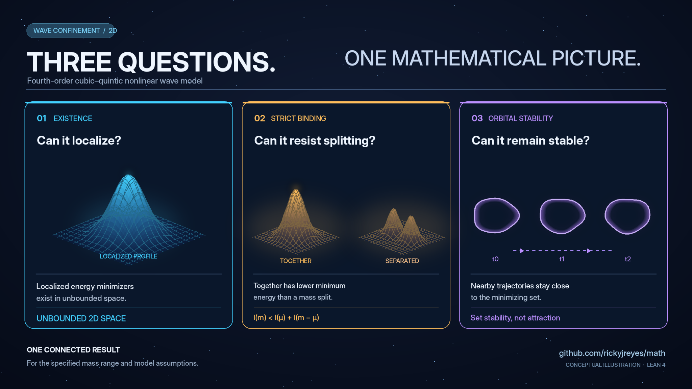

# Reyes Problem Repository

**[Browse all 300 mathematical research questions, by subject and status](./ROADMAP_300.md)** · [✅ Completed mathematical results](./VERIFIED_LEAN_RESULTS.md) · [Contribute a proof or counterexample](./CONTRIBUTING.md)

**Mathematical questions about nonlinear waves, confinement, geometry, and computation**

A research collection maintained by Richard J. Reyes. Its purpose is to formulate precise mathematical questions, document proved results and counterexamples, and make the remaining problems accessible to independent mathematicians. Several questions are motivated by Wave Confinement Theory (WCT), but a mathematical theorem here does not by itself establish a physical theory.

**Further resources:** [Papers](../CONTENTS.md) · [Scoped mathematical dossiers](./scoped/README.md) · [Difficulty-rating rubric](./DIFFICULTY_RUBRIC.md) · [Technical documentation](./docs/README.md)

## What is in this collection?

There are **300 research candidates across 12 mathematical subjects**. **GC01–GC65** have preserved, explicit mathematical problem statements; **GC66–GC300** retain their historical research sketches and now have [235 linked scope-v1 benchmark dossiers](./scoped/README.md), with proposed mathematical models, first tests and outstanding prior-art/review obligations. The catalogue is **not** a claim to have identified 300 novel unsolved problems. The [problem index](./ROADMAP_300.md) distinguishes formal questions from unreviewed drafts and links to an individual page for every GC identifier. The [12 subject folders](./problems/README.md) provide another route into the collection.

The main subjects are nonlinear PDEs, variational analysis, curvature and differential geometry, spectral theory, inverse problems, topological structures, formal verification, and mathematical models of computation. Contributions may prove a proposition, produce a counterexample, sharpen a hypothesis, identify a known theorem, or formulate a testable new problem.

## Established mathematical results

The repository already contains rigorous papers and Lean 4 formalizations, including a linked chain for the two-dimensional fourth-order cubic–quintic Schrödinger equation

```math
i\partial_t u=(\Delta+k^2)^2u-\beta|u|^2u+\gamma|u|^4u,
\qquad \beta,\gamma>0.
```

For this model, **strict binding, constrained minimizer existence, global evolution, and stability of the minimizing set** are established under an explicit sufficient mass range. The result concerns the set of minimizers, not every standing-wave profile. Separate formalizations address an exact 20-dimensional local observation fiber, curvature-closure nonuniqueness, Fourier analysis, and higher-derivative obstructions.

### Visual guide to the F01 results

[](../docs/figures/research-posts/README.md)

The illustration connects three **distinct, scoped mathematical theorems** for the model above: [whole-space minimizer existence](../lean/MathProofs/WholeSpaceMinimizers.lean), [strict binding](../lean/MathProofs/StrictBinding.lean), and [orbital stability of the complete minimizing set](../lean/MathProofs/OrbitalStability.lean), all in their specified sufficient mass range. It is **conceptual artwork, not PDE numerical output or a depiction of a proved minimizer shape**.

[Explore the four illustrated results](../docs/figures/research-posts/README.md): [localization](../docs/figures/research-posts/wave-without-walls.png) · [binding](../docs/figures/research-posts/strict-binding.png) · [orbital stability](../docs/figures/research-posts/orbital-stability.png) · [combined overview](../docs/figures/research-posts/existence-binding-stability.png).

**[Read the 20 selected completed Lean results with their precise scopes, source files, and paper links](./VERIFIED_LEAN_RESULTS.md).** A green **✅ COMPLETE** applies to the *stated theorem*, never automatically to a broader GC challenge, and is not evidence of experimental confirmation or international mathematical novelty.

### Five problems to start with

| Problem | What is already known here? | What remains to establish? |
|---|---|---|
| **[GC01: Universal orbital stability](./flagship/GC01.md)** ([formal statement](./FORMAL_PROBLEMS.md#gc01-universal-orbital-stability)) | ✅ Stability of a constrained minimizing set in a defined mass range | Characterize non-minimizing and excited standing waves |
| **[GC06: Self-confinement](./flagship/GC06.md)** ([formal statement](./FORMAL_PROBLEMS.md#gc06-self-confinement-criteria)) | ✅ Minimizers and compactness for a sufficient parameter range | Determine exact attainment and failure regimes |
| **[GC11: Nonlinear wavelength selection](./flagship/GC11.md)** ([formal statement](./FORMAL_PROBLEMS.md#gc11-nonlinear-finite-wavelength-selection)) | An exact linear dispersion minimum is known | Prove or refute genuinely nonlinear wavelength selection |
| **[GC36: Stable knotted waves](./flagship/GC36.md)** ([formal statement](./FORMAL_PROBLEMS.md#gc36-stable-knotted-wave-configurations)) | A candidate topological question is formulated | Construct a stable knot in a specified model or prove an obstruction |
| **[GC43: Wave-cell computational universality](./flagship/GC43.md)** ([formal statement](./FORMAL_PROBLEMS.md#gc43-discrete-wave-computational-universality)) | A proposed discrete computation question is formulated | Freeze a local rule and prove its simulation power and overhead |

One further example illustrates how negative results count: **[GC08: admissible curvature closures](./problems/02-confinement-curvature/GC08.md)** is **partially resolved** by a formal nonuniqueness construction. A complete classification under additional requirements remains open.

## How to read a problem

Start with the [subject-organized index](./ROADMAP_300.md). Each entry points to an individual GC page. For GC01–GC65, the [preserved formal statements](./FORMAL_PROBLEMS.md) specify the original research questions. The five dossiers above include explicit models, research boundaries, known work, and possible proof tests. For GC66–GC300, follow the [scope-v1 dossier](./scoped/README.md) to a benchmark model, falsifiable milestone and audit cautions. These are still *unreviewed research drafts*, not fully frozen or known-open theorem statements. [Provisional difficulty ratings](DIFFICULTY_RUBRIC.md) accompany all 300 entries.

The distinction between an established partial result and a full classification matters. For example, a theorem proving strict binding for a specified interval of masses does not solve a problem asking for **all** masses. The [verified-results index](./VERIFIED_LEAN_RESULTS.md) records exact positive and negative mathematical conclusions separately from GC status.

## How to contribute

Find a question in the [index](./ROADMAP_300.md), read its assumptions and existing research, and compare the nearest published literature. Contributions may include conventional proofs, Lean statements, counterexamples, or rigorously scoped negative results. Use the existing [GitHub issues](https://github.com/rickyjreyes/math/issues) when possible; avoid duplicating research tasks. The [contribution guide](./CONTRIBUTING.md) describes the proof, attribution, and review requirements.

**Publication and verification are distinct.** A Lean build checks the formal proposition as encoded; independent review is still needed to establish correspondence with a conjecture or manuscript. Numerical evidence, physical interpretations, and novelty claims require their own scrutiny. The mathematical research is intended to stand on its own merits while the larger WCT research program remains an independently testable physical hypothesis.

For detailed audits, adoption mappings, historical notes, registries, and workflow scripts, see **[Technical documentation](./docs/README.md)**.
