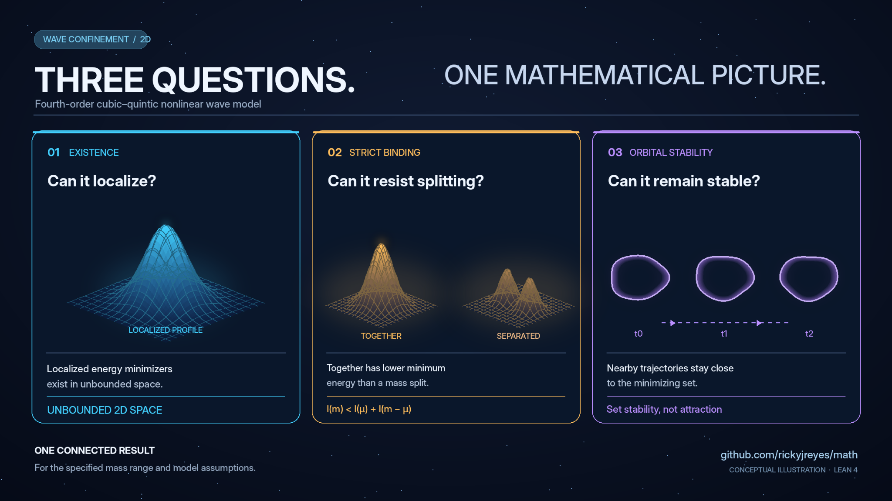

# Verified mathematical results

**20 selected Lean 4 proof modules**, grouped by mathematical subject. **✅ COMPLETE** means that the *exact theorem described in that row* has been formalized in the linked source. It does **not** mean a related general research problem is solved. These sources were located in their respective repositories on 2026-11-02. This index is not a new independent Lean build, mathematical novelty audit, or physical experiment.

**[Research overview](./README.md) · [300 problems](./ROADMAP_300.md) · [Manuscript catalogue](../CONTENTS.md) · [Documentation](./docs/README.md)**

## Fourth-order evolution, minimizers and Fourier analysis

The central model studied by several results is

```math
i\partial_t u=(\Delta+k^2)^2u-\beta|u|^2u+\gamma|u|^4u
\quad\text{on }\mathbb R^2,\qquad \beta,\gamma>0.
```

For its constrained energy, the established sufficient range is **$0<m\le m_B$**, where **$m_B=3\beta/(\gamma\sqrt{k^4+3\beta^2/(32\gamma)})$**. This does not characterize all masses.

### Illustrated guide to the F01 theorem chain

[](../docs/figures/research-posts/README.md)

The linked [four-figure gallery](../docs/figures/research-posts/README.md) illustrates [minimizer existence](../docs/figures/research-posts/wave-without-walls.png), [strict binding](../docs/figures/research-posts/strict-binding.png), and [full-set orbital stability](../docs/figures/research-posts/orbital-stability.png). These are **schematics, not computed states, proof certificates, or evidence of a new GC resolution**. The theorems below, not the drawings, establish the precise claims.

| Complete result | Exact mathematical conclusion | Lean proof | Relation to GC questions |
|---|---|---|---|
| ✅ **Orbital stability** | Orbital stability of the **full set of constrained minimizers** in $H^2(\mathbb R^2)$, in the sufficient mass range; not uniqueness or profile-wise stability | [OrbitalStability.lean](../lean/MathProofs/OrbitalStability.lean), [paper](../papers/orbital-stability-fourth-order-cubic-quintic/main.tex) | [GC01](problems/01-wave-dynamics/GC01.md), partial |
| ✅ **Strict binding** | $I(m)<I(a)+I(m-a)$ for every split $0<a<m$ in the proved mass range | [StrictBinding.lean](../lean/MathProofs/StrictBinding.lean), [paper](../papers/strict-subadditivity-fourth-order-cubic-quintic/main.tex) | [GC06](problems/02-confinement-curvature/GC06.md), [GC16](problems/04-variational-solitons/GC16.md), partial |
| ✅ **Global nonlinear flow** | Global $H^2$ existence, uniqueness, continuous dependence, mass and energy conservation for this two-dimensional equation | [CubicQuinticFlow.lean](../lean/MathProofs/CubicQuinticFlow.lean) | [GC03](problems/01-wave-dynamics/GC03.md), partial; [GC46](problems/10-lean-certified-analysis/GC46.md), exact correspondence not yet signed off |
| ✅ **Curvature nonattainment** | Positive-curvature whole-space energy admits no minimizer in the specified setting; strict spreading in dimensions 1–4 | [CurvatureNonattainment.lean](../lean/MathProofs/CurvatureNonattainment.lean) | Related to localization, not a general confinement theorem |
| ✅ **E68 dimension classification** | The particular quantified local $H^1$ gradient estimate holds exactly in spatial dimension two | [E68Classification.lean](../lean/MathProofs/E68Classification.lean) | Related to [GC10](problems/02-confinement-curvature/GC10.md), not its full classification |
| ✅ **Whole-space $L^2$ Fourier analysis** | Unitary Fourier construction on genuine $L^2$ classes; exclusion of nonzero $L^2$ states supported on a measure-zero frequency shell | [L2Fourier.lean](../lean/MathProofs/L2Fourier.lean) | Related to [GC14](problems/03-spectral-scattering/GC14.md) |
| ✅ **Fourier contraction semigroup** | Exact continuous-operator $L^2$ semigroup identity and contractivity for the stated Fourier multiplier | [E57L2Semigroup.lean](../lean/MathProofs/E57L2Semigroup.lean) | Related to [GC48](problems/10-lean-certified-analysis/GC48.md) |

## Inverse problems, curvature and higher-derivative fields

| Complete result | Exact mathematical conclusion | Lean proof | Relation to GC questions |
|---|---|---|---|
| ✅ **V18 local non-identifiability** | Nonlinear $20$-dimensional local fiber of the specified $31$-parameter to $11$-observation map, at the stated frozen model | [V18Identifiability.lean](../lean/MathProofs/V18Identifiability.lean) | [GC26](problems/06-inverse-observation-control/GC26.md), partial |
| ✅ **V18 Jacobian rank** | Exact rank $11$ and nullity $20$ at the designated parameter point | [V18Rank.lean](../lean/MathProofs/V18Rank.lean) | [GC26](problems/06-inverse-observation-control/GC26.md), partial |
| ✅ **M6B curvature closure nonuniqueness** | Infinitely many smooth M6B **Laplacian-quotient** closures satisfy the M6B manuscript's stated axioms | [M6BClosureTheorem.lean](../lean/MathProofs/M6BClosureTheorem.lean) | [GC08](problems/02-confinement-curvature/GC08.md) has a **different phase-current operator** and an independent analytical counterexample; exact Lean correspondence not established |
| ✅ **M6B smooth-field closure witness** | Distinct M6B closures are distinguishable on an actual smooth field, not just formal jets | [M6BClosureFieldWitness.lean](../lean/MathProofs/M6BClosureFieldWitness.lean) | Separate M6B theorem; **not** direct formal verification of the GC08 phase-current operator |
| ✅ **Auxiliary-field obstruction** | Rewriting the specified regular higher-time-derivative temporal-jet model does not remove its Hamiltonian obstruction | [R16_AuxiliaryEquivalence.lean](https://github.com/rickyjreyes/geometry_of_resonance/blob/main/lean/ReleaseProofs/R16_AuxiliaryEquivalence.lean) | Higher-derivative questions, restricted class |
| ✅ **Completion-class obstruction** | A delimited higher-derivative failure class and a distinct competing spatial action | [R16_CompletionClasses.lean](https://github.com/rickyjreyes/geometry_of_resonance/blob/main/lean/ReleaseProofs/R16_CompletionClasses.lean) | [GC21](problems/05-higher-derivative-fields/GC21.md), partial |
| ✅ **Static finite-wavenumber onset** | Exclusion of a primary finite-$q$ zero-frequency onset in the stated static homogeneous S004 sector | [R18_Onset.lean](https://github.com/rickyjreyes/geometry_of_resonance/blob/main/lean/ReleaseProofs/R18_Onset.lean) | [GC23](problems/05-higher-derivative-fields/GC23.md), partial |
| ✅ **Canonical static selection obstruction** | Static spatial-selection obstruction and conditional pole-positivity statements in the specified sector | [R18_CanonicalObstruction.lean](https://github.com/rickyjreyes/geometry_of_resonance/blob/main/lean/ReleaseProofs/R18_CanonicalObstruction.lean) | [GC23](problems/05-higher-derivative-fields/GC23.md), partial |

## Proof certificates, computation and statistical methods

| Complete result | Exact mathematical conclusion | Lean proof | Boundary |
|---|---|---|---|
| ✅ **Operator block enclosure** | A rigorous *conditional* operator-norm bound and sound checker given certified block and global-error inputs | [BlockEnclosure.lean](https://github.com/rickyjreyes/wct-pde/blob/main/formal/D4Certificates/BlockEnclosure.lean) | Does not itself certify a production numerical operator |
| ✅ **Randomization-test validity** | Finite exact type-I error control under declared randomization/exchangeability hypotheses | [Randomization.lean](https://github.com/rickyjreyes/photodiode/blob/main/formal/PhotodiodeProtocol/Randomization.lean) | Does not establish an optical effect |
| ✅ **Split-SAT communication capacity** | Exact split-SAT construction and finite-alphabet information lower bound in the defined model | [SplitSATCapacity.lean](https://github.com/rickyjreyes/PVNP/blob/main/lean/PVNP/SplitSATCapacity.lean) | Does not solve $P$ versus $NP$ |
| ✅ **Transcript-count lower bound** | Exponential accepting-transcript bound using the specified communication fooling set | [Communication.lean](https://github.com/rickyjreyes/PVNP/blob/main/lean/PVNP/Communication.lean) | Does not imply a general Turing-machine lower bound |
| ✅ **Multi-block state structure** | Proven properties of the defined block-absorption construction and structural non-injectivity limits | [MultiBlock.lean](https://github.com/rickyjreyes/Wavelock/blob/main/lean/WaveLockProofs/MultiBlock.lean) | Does not prove general cryptographic collision resistance |

## What remains open?

**Dated operator-correspondence correction (November 2, 2026):** The two completed Lean rows above are correct **M6B** results, not an exact Lean proof of the different operator in GC08. GC08's explicit phase-current-divergence uniqueness counterexample is analytical; its remaining classification is open. This editorial correction changes no theorem and no machine GC status. See the [audit ledger](../docs/NEGATIVE_RESULT_SCOPE_AUDIT_2026-11-02.md).

**GC progress is separate from theorem completion.** The [machine registry](problem_registry.json) currently records **299 candidates, one partially resolved problem (GC08), and no fully accepted GC resolutions**. For example, proof of one minimizer-stability theorem does not classify all excited standing waves, and an exact 20-dimensional local observation fiber does not classify global injectivity.

The [existing-results adoption map](GC65_ADOPTION.md) cross-references earlier mathematics to GC01–GC65, but a GC status can change only after matching the *whole* stated claim to the formal result. The [technical documentation](docs/README.md) preserves the CI, review and scope requirements. Independent mathematical novelty has not been established merely by listing a checked theorem.
