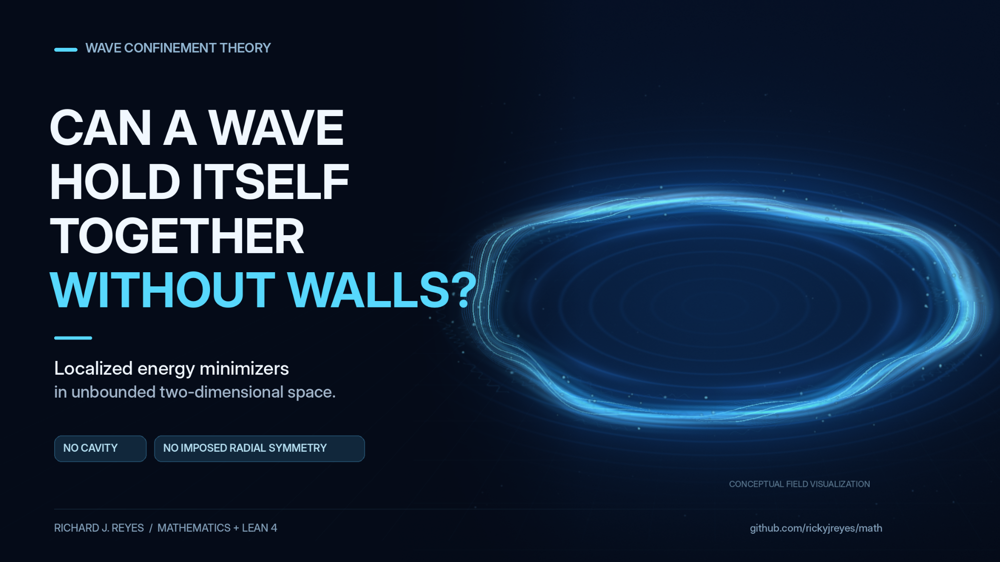

# GC06: Self-confinement criteria

**Status:** `candidate` (original catalogue, not an independent novelty or open-problem certification)

**✅ COMPLETE (existing Lean theorems):** [Whole-space minimizer existence](../../../lean/MathProofs/WholeSpaceMinimizers.lean) and [strict binding](../../../lean/MathProofs/StrictBinding.lean) in the proved mass range. **⚪ GC06 remains a candidate:** the all-parameter classification is not proved.

[**✅ All 20 completed Lean results**](../../VERIFIED_LEAN_RESULTS.md)

**Canonical mathematical statement:** [FORMAL_PROBLEMS.md](../../FORMAL_PROBLEMS.md#gc06-self-confinement-criteria).

## GC06: Self-confinement criteria

**Problem.** For $E(u)=\int_{\mathbb R^2}\left(|(\Delta+k^2)u|^2-\frac\beta2|u|^4+\frac\gamma3|u|^6\right)\,dx$ at fixed ∥u∥²₂=m, determine exactly which (k,β,γ,m) admit an attained infimum and characterize loss of compactness.

**Resolution criterion.** Supply a theorem with all quantifiers, domains, topologies and parameters fixed, together with a proof or an explicit counterexample. Compare against existing results and verify only the exact encoded claims in Lean where applicable.

**Research record:** Update the [status register](../../STATUS.md) and [machine registry](../../problem_registry.json) together if an exact claim is resolved. The original statement is preserved above for reference.

## Related research illustration

[Figure provenance and cautions](../../../docs/figures/research-posts/README.md) · [Formal theorem](../../../lean/MathProofs/WholeSpaceMinimizers.lean).

**Scope:** The proved result establishes minimizer existence in a sufficient mass range with compactness modulo translations, **not** the whole GC06 mass/parameter classification or a particular ring-shaped minimizer. This is schematic artwork, **not** a numerical PDE solution or proof certificate.

## Existing research alignment

**Relationship:** Direct result covering a narrower case. **GC-to-Lean correspondence:** not yet audited. These research pointers do not modify or resolve the original mathematical question.

- **Existing Lean modules:** [WholeSpaceMinimizers.lean](../../../lean/MathProofs/WholeSpaceMinimizers.lean), [StrictBinding.lean](../../../lean/MathProofs/StrictBinding.lean), [NegativeEnergy.lean](../../../lean/MathProofs/NegativeEnergy.lean).
- **Candidate Lean declarations:** `ReyesMath.WholeSpace.main`, `ReyesMath.StrictBinding.strict_binding`, `ReyesMath.NegativeEnergy.negative_constrained_energy`.
- **Existing paper sources:** [whole-space-fourth-order-cubic-quintic-minimizers](../../../papers/whole-space-fourth-order-cubic-quintic-minimizers/main.tex), [strict-subadditivity-fourth-order-cubic-quintic](../../../papers/strict-subadditivity-fourth-order-cubic-quintic/main.tex), [negative-constrained-energy-cubic-quintic](../../../papers/negative-constrained-energy-cubic-quintic/main.tex).
- **GC issue:** [GC research milestone #55](https://github.com/rickyjreyes/math/issues/55).
- **Related formalization issues:** None recorded.
- **Remaining mathematical distinction:** Existence and strict binding in a sufficient mass range do not classify all mass and parameter regimes.

[GC01–GC65 adoption map](../../GC65_ADOPTION.md) · [Paper ↔ Lean completion contract](../../WORKFLOW.md).
