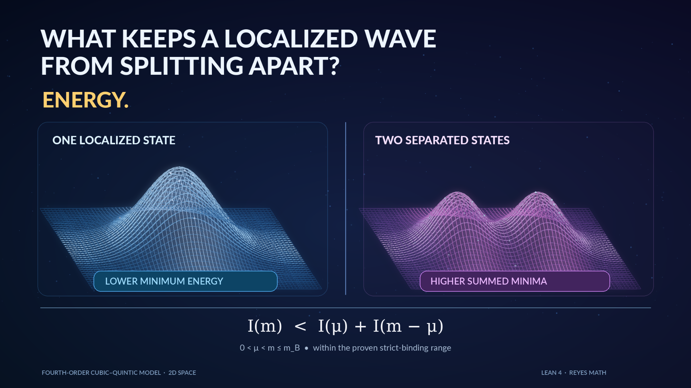

# GC16: Strict binding across masses

**Status:** `candidate` (original catalogue, not an independent novelty or open-problem certification)

**✅ COMPLETE (existing Lean theorem):** [Strict subadditivity](../../../lean/MathProofs/StrictBinding.lean) for the explicitly proved sufficient mass range, including the frozen-parameter instance. **⚪ GC16 remains a candidate:** the all-mass classification is not proved.

[**✅ All 20 completed Lean results**](../../VERIFIED_LEAN_RESULTS.md)

**Canonical mathematical statement:** [FORMAL_PROBLEMS.md](../../FORMAL_PROBLEMS.md#gc16-strict-binding-across-masses).

## GC16: Strict binding across masses

**Problem.** For the energy in GC06, determine all masses m>0 satisfying strict subadditivity $I(m)<I(a)+I(m-a)$ for every 0<a<m, where $I(m)=\inf_{\|u\|_{L^2}^2=m}E(u)$.

**Resolution criterion.** Supply a theorem with all quantifiers, domains, topologies and parameters fixed, together with a proof or an explicit counterexample. Compare against existing results and verify only the exact encoded claims in Lean where applicable.

**Research record:** Update the [status register](../../STATUS.md) and [machine registry](../../problem_registry.json) together if an exact claim is resolved. The original statement is preserved above for reference.

## Related research illustration

[Figure provenance and cautions](../../../docs/figures/research-posts/README.md) · [Formal theorem](../../../lean/MathProofs/StrictBinding.lean).

**Scope:** The theorem states `I(m) < I(μ) + I(m − μ)` for `0 < μ < m ≤ m_B` under the stated assumptions. **It does not establish strict binding for every mass**, which GC16 requests. This is schematic artwork, **not** a numerical PDE solution or proof certificate.

## Existing research alignment

**Relationship:** Direct result covering a narrower case. **GC-to-Lean correspondence:** not yet audited. These research pointers do not modify or resolve the original mathematical question.

- **Existing Lean modules:** [StrictBinding.lean](../../../lean/MathProofs/StrictBinding.lean), [NegativeEnergy.lean](../../../lean/MathProofs/NegativeEnergy.lean).
- **Candidate Lean declarations:** `ReyesMath.StrictBinding.strict_binding`, `ReyesMath.NegativeEnergy.negative_constrained_energy`.
- **Existing paper sources:** [strict-subadditivity-fourth-order-cubic-quintic](../../../papers/strict-subadditivity-fourth-order-cubic-quintic/main.tex), [negative-constrained-energy-cubic-quintic](../../../papers/negative-constrained-energy-cubic-quintic/main.tex).
- **GC issue:** No dedicated GC issue mapped; search current issues before opening one.
- **Related formalization issues:** None recorded.
- **Remaining mathematical distinction:** Strict subadditivity is formalized over a sufficient small-mass regime; GC16 requests every mass.

[GC01–GC65 adoption map](../../GC65_ADOPTION.md) · [Paper ↔ Lean completion contract](../../WORKFLOW.md).
